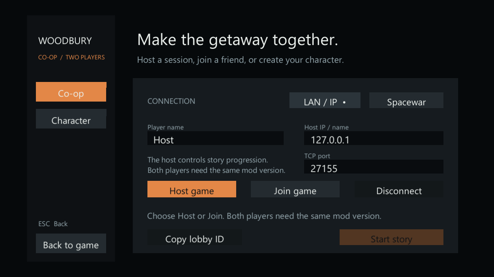
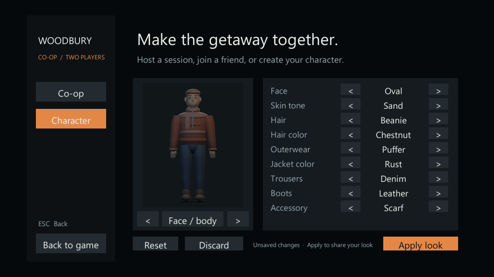

# Woodbury Co-op

Experimental two-player mod for **Fears to Fathom: Woodbury Getaway** on Windows. The host runs the story; the client receives synchronized state. **Full story parity is not verified.**

<!-- AUTO:STATUS-BEGIN -->
[Live status & roadmap](https://tudorek12345.github.io/fears-to-fathom-woodbury-getaway-mp-mod/)

<!-- Auto-generated by scripts/Update-SiteData.ps1 -- do not hand-edit. -->

**Plugin** `0.4.49` · **Protocol** `7` · **Experimental test build**

Scene smoke tests pass; complete story parity and two-PC Spacewar gameplay remain unverified.
<!-- AUTO:STATUS-END -->

## Current build

- Native **Multiplayer** entry with Co-op and Character tabs.
- Original animated traveler: face, skin, hair, clothing and accessories; rotating preview and saved looks shared with your partner.
- Head/body/limb poses, movement and seating; scene-specific world, NPC, dialogue and selected story-state synchronization.
- LAN/IP and Spacewar transports, including a UTF-8 Windows helper startup fix. **The reported Spacewar join-then-disconnect problem is not confirmed fixed on two PCs.**

**Verified in 0.4.49:** 873 managed/log checks, both native helper suites, and paired TCP-only / TCP+UDP scene-entry sweeps across all ten build scenes (Disclaimer boot only). Focused graphics checks cover the menus, previews and remote character changes. These are smoke tests, not completed story playthroughs.

**Still unverified:** complete story and endings, save/resume, gameplay reconnect, two-account Internet Spacewar play and visual calibration in every scene. See [validation evidence](docs/VALIDATION-0.4.49.md) and the [live status / screenshots](https://tudorek12345.github.io/fears-to-fathom-woodbury-getaway-mp-mod/).

## Install

1. Both players need their own Windows/Steam game installation and the **same mod package**.
2. Download the [0.4.49 test package](https://tudorek12345.github.io/fears-to-fathom-woodbury-getaway-mp-mod/downloads/woodbury-coop-latest.7z). Extract into the game folder, with `winhttp.dll`, `doorstop_config.ini` and `BepInEx/` beside the executable. Back up custom configs first.
3. Launch and select **Multiplayer** above Episodes, or press **F11**.
4. Select **LAN / IP** on both PCs (TCP 27055, UDP 27056), or **Spacewar** with separate Steam accounts. Host, then join using the host IP or copied lobby ID. Disconnect before changing transports.
5. The host selects **Start story**, or returns to the game menu to choose a checkpoint.

For disconnects, run the packaged `Collect-CoopDiagnostics.ps1` after reproducing on each PC. It collects logs and installed file hashes locally; nothing is uploaded. [Install details](INSTALL.txt) · [Build manifest](site/downloads/build-info.json)

## Screenshots

Actual development captures; the character model is stylized and still being refined.




## Build and test

Requires a .NET SDK, BepInEx 5 Mono and local game/Unity reference assemblies.

```powershell
.\scripts\CopyLibs.ps1 -GameDir "<GameDir>"
.\scripts\Build.ps1
.\scripts\Test-SyncRegression.ps1
```

[Native Spacewar helper](tools/SpacewarHelper/README.md) · [Scene smoke tests and limitations](docs/VALIDATION-0.4.49.md) · [Changelog](CHANGELOG.md)

## License & Ownership

**Copyright © 2026 tudorek12345 ("Heperkoo"). All rights reserved.**

This project is **proprietary and source-available for reference only** — it is **not**
open source. It is the sole creation of the Author and is **intended to be modified,
built, maintained, and distributed only by the Author.**

Without the Author's prior written permission you may **not** copy, modify, build,
re-upload, redistribute, sell, rebrand, or create derivative works from this project
or its build output, on any platform. Viewing the public source for personal reference
is permitted; everything else is reserved. See **[LICENSE.md](LICENSE.md)** for the
full, binding terms.

This is an **unofficial fan modification** for *Fears to Fathom: Woodbury Getaway*. It
is not affiliated with, endorsed by, or sponsored by the game's developer or publisher.
*"Fears to Fathom"*, *"Woodbury Getaway"*, and all related names, marks, characters, and
assets belong to their respective owner(s); they are not licensed or claimed here, and
this license covers only the Author's own original work.

For permission or commercial-use requests: [GitHub](https://github.com/tudorek12345) ·
[Discord](https://discord.gg/tyEhwgSxzV).
